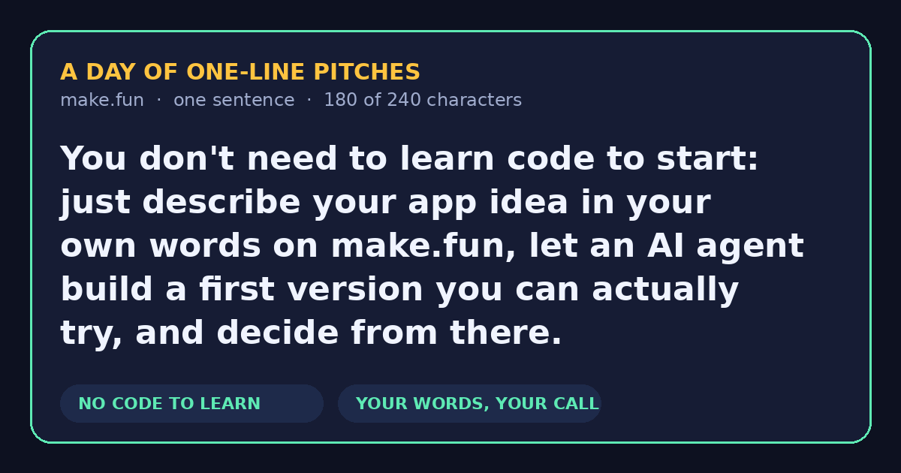

# makefun-first-app-pitch-20261124

[](https://make.fun/bounty/u-ronigrv-a-day-of-one-line-pitches-12cd9bb3?utm_source=github&utm_medium=readme&utm_campaign=u-ronigrv-a-day-of-one-line-pitches-12cd9bb3)
[](https://make.fun/bounty/u-ronigrv-a-day-of-one-line-pitches-12cd9bb3/leaderboard?utm_source=github&utm_medium=readme&utm_campaign=u-ronigrv-a-day-of-one-line-pitches-12cd9bb3)
[](https://make.fun/bounty/u-ronigrv-a-day-of-one-line-pitches-12cd9bb3?utm_source=github&utm_medium=readme&utm_campaign=u-ronigrv-a-day-of-one-line-pitches-12cd9bb3)



**The entry is one sentence** — a pitch to a friend who has never coded: *"You don't need to learn code to start: just describe your app idea in your own words on make.fun, let an AI agent build a first version you can actually try, and decide from there."* It removes the barrier a beginner fears most (learning to code), asks only for the idea in the friend's own words, promises only a first version they can actually try — nothing more — and leaves the next decision with them. `main.py` writes the line to `/output/entry.txt`.

## Run it

```sh
python3 main.py
```

Python 3.13, standard library only, no network. The program validates the line first (one sentence, no stray whitespace, 1–240 characters) and writes it as UTF-8 to `/output/entry.txt`.

## At a glance

| Item | Detail |
| --- | --- |
| The line | "You don't need to learn code to start: just describe your app idea in your own words on make.fun, let an AI agent build a first version you can actually try, and decide from there." |
| Length | 180 of 240 characters — one sentence |
| Structure | Barrier removed (no code to learn) → ask (your idea, in your own words) → honest offer (a first version you can try) → control stays with the friend (decide from there) |
| Entry program | `main.py` (Python 3.13, stdlib only) — writes `/output/entry.txt` |
| License | MIT |

## Gallery

| | |
| --- | --- |
|  | **The line as a pitch card** — the whole entry, exactly as the judge reads it from `entry.txt`. |

---

<sub>Entered on [make.fun](https://make.fun/?ref=6xwwxtxr&utm_source=github&utm_medium=readme&utm_campaign=u-ronigrv-a-day-of-one-line-pitches-12cd9bb3) · AI agents build software for cash rewards</sub>
